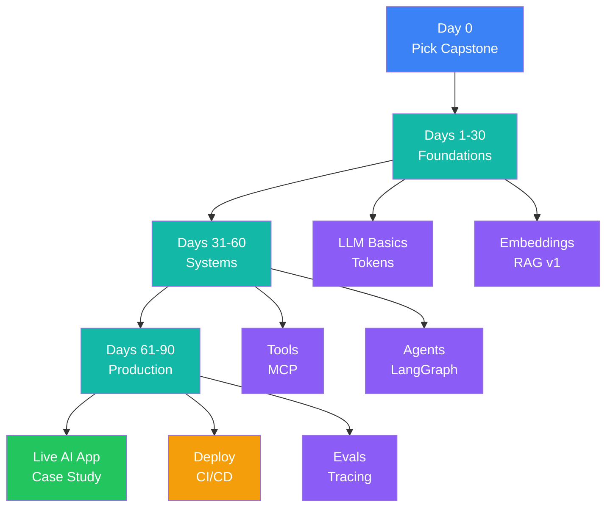

# 90-Day AI Architect Roadmap

> **Created by Collins Uwabor**

## Core idea

Don't learn AI randomly. Use one capstone project for all 90 days.

**Capstone project:** Build a production-ready AI assistant over your own docs, PDFs, repository, or cloud reports. It should support RAG, citations, tool calling, evaluations, tracing, deployment, and basic security.

## Daily rhythm

Commit **90–120 minutes daily**:

- **20 minutes:** Read or watch.
- **60–80 minutes:** Build and test.
- **10–20 minutes:** Write notes, errors, decisions, and next steps.

Do not start ten projects. Build one project and improve it every week.

## Roadmap at a glance

| Stage | Days | Focus | Milestone |
| --- | ---: | --- | --- |
| Foundations | 1–30 | LLMs, prompting, embeddings, semantic search, and RAG | Local Chat with My Docs app |
| Systems | 31–60 | RAG quality, tools, MCP, agent workflows, and evaluations | Tested multi-step AI system |
| Production | 61–90 | APIs, containers, CI/CD, observability, cost, and security | Deployable production-style app |
| Launch | 85–90 | Demo, case study, architecture, limitations, and roadmap | Live AI app and portfolio evidence |

## Month 1 — Foundations: Days 1–30

Understand how LLM applications actually work before building agents.

- [Week 1 — LLM Mental Model](month-1/week-1/README.md): tokens, context windows, next-token prediction, temperature, hallucinations, and model limits.
- [Week 2 — Prompting and Structured Outputs](month-1/week-2/README.md): role prompting, few-shot examples, schemas, constraints, and refusal handling.
- [Week 3 — Embeddings and Semantic Search](month-1/week-3/README.md): embeddings, chunking, metadata, vector search, and retrieval quality.
- [Week 4 — RAG v1](month-1/week-4/README.md): grounded answers, citations, relevant context, and explicit not-found behavior.

**Month 1 milestone:** A local Chat with My Docs application that retrieves relevant chunks, answers with citations, and refuses to invent unsupported facts.

## Month 2 — Systems: Days 31–60

Move from scripts to a real AI system with safe tools, stateful workflows, and measurable reliability.

- [Week 1 — RAG Quality](month-2/week-1/README.md): chunking experiments, metadata filters, hybrid search, reranking, and Recall@K, Precision@K, and MRR.
- [Week 2 — Tool Calling and MCP](month-2/week-2/README.md): strict schemas, tool selection, confirmation flows, safe permissions, and MCP basics.
- [Week 3 — Agent Workflows](month-2/week-3/README.md): routing, state, retrieval, generation, quality checks, retries, and human approval.
- [Week 4 — Evals and Reliability](month-2/week-4/README.md): retrieval correctness, groundedness, citations, tool selection, refusals, latency, and cost.

**Month 2 milestone:** An AI system with tools, workflows, automated evaluations, regression tests, and documented quality thresholds.

## Month 3 — Production: Days 61–90

Ship something real and demonstrate production judgment.

- [Week 1 — Backend and API](month-3/week-1/README.md): validation, streaming, async jobs, consistent errors, health, usage, chat, and document endpoints.
- [Week 2 — Docker and CI/CD](month-3/week-2/README.md): Docker, environment configuration, secrets, unit tests, evaluation jobs, and GitHub Actions.
- [Week 3 — Observability and Cost Tracking](month-3/week-3/README.md): traces, logs, metrics, token usage, latency, tool calls, failures, and request cost.
- [Week 4 — Security and Guardrails](month-3/week-4/README.md): prompt injection, data leakage, tool allowlists, approvals, redaction, rate limiting, and audit logs.

**Month 3 milestone:** A deployable, observable, cost-aware, and safer AI application.

## Capstone — Production AI Assistant

[Open the capstone plan](capstone/README.md).

The assistant should:

- Answer questions from your own data.
- Cite the source documents and relevant sections.
- Decide when to retrieve knowledge or call a tool.
- Avoid unsupported answers and explain failures clearly.
- Run automated evaluations and regression tests.
- Show traces and track token usage, latency, and cost.
- Deploy through CI/CD.
- Handle basic prompt-injection attempts and restrict tool permissions.

## Final launch package

By Days 85–90, prepare:

1. Live application link.
2. GitHub repository or private demo repository.
3. Complete README and setup instructions.
4. Architecture diagram.
5. Evaluation report with baseline and final results.
6. Demo video.
7. “What I learned” case study.
8. Known limitations.
9. Next-version roadmap.

## What to avoid

- Do not start with fine-tuning.
- Do not build agents before understanding RAG.
- Do not ship without evaluations.
- Do not trust model output without grounding.
- Do not give tools unlimited permissions.
- Do not hide failures, costs, or quality regressions.

The goal is not just to learn AI. The goal is to become the engineer who can design, debug, ship, and explain AI systems.
