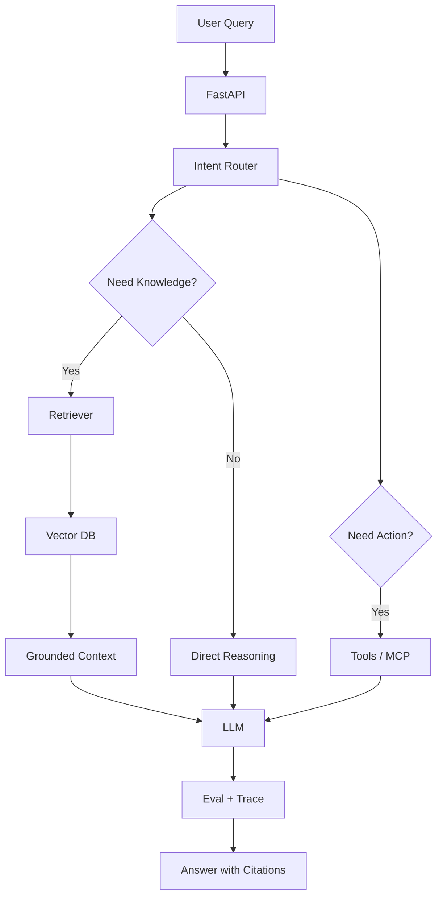

# Capstone — Production AI Assistant

Build one production-ready AI assistant over your own documentation, PDFs, repository, or cloud reports. Every week of the roadmap should improve this same project.

## Required capabilities

- Retrieval-augmented generation over your own data
- Source citations
- Tool calling and MCP
- Multi-step workflow or agent routing
- Evaluation datasets and regression tests
- Tracing and cost tracking
- CI/CD deployment
- Basic security and guardrails

## Suggested architecture

## Days 85–90: launch and case study

Prepare:

1. Live app link
2. GitHub repository or private demo repository
3. Complete README
4. Architecture diagram
5. Evaluation report
6. Demo video
7. What I learned case study
8. Known limitations
9. Next-version roadmap

## Final acceptance criteria

The application must:

- Answer from your own data
- Cite sources
- Use tools when needed
- Avoid unsupported answers
- Run evaluations
- Show traces
- Track cost
- Deploy from CI/CD
- Handle basic prompt injection attempts
- Explain failures clearly

## Evidence to collect

Keep screenshots, logs, evaluation results, architecture decisions, failed experiments, and before/after metrics. The final case study should explain not only what works, but how you debugged failures and what tradeoffs you made.
